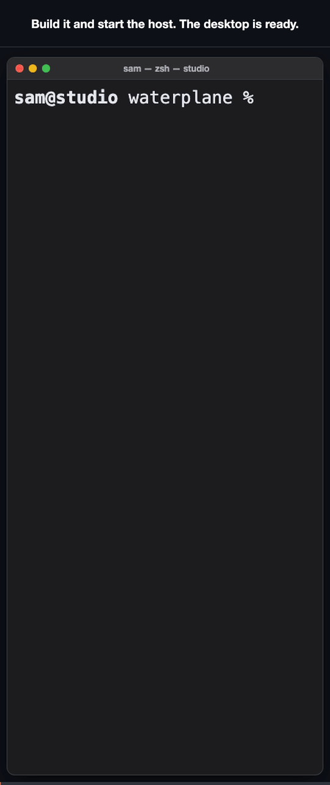
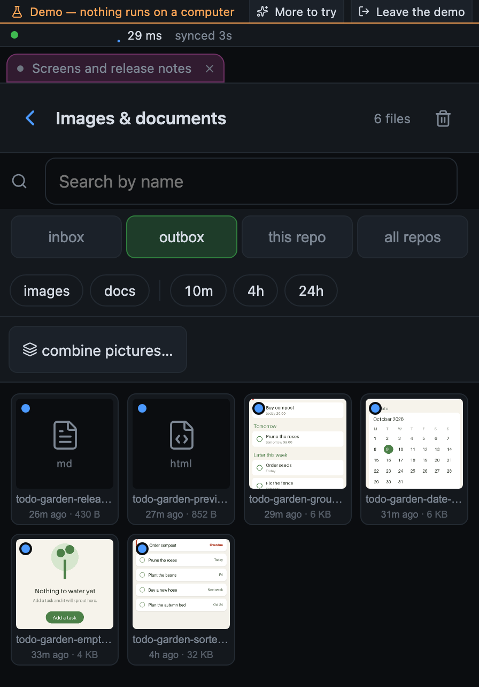
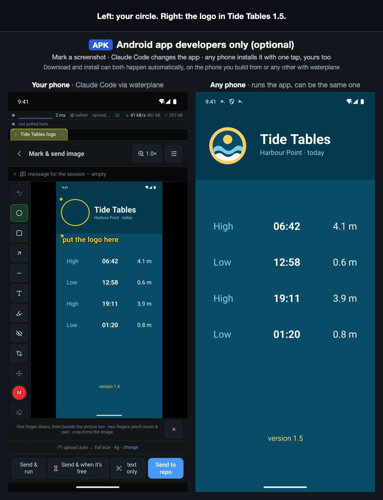

# waterplane

<!-- site:intro -->
**An IDE, rethought for the phone in the age of agentic coding.** The agent writes the code; what
you need in your hand is the steering. waterplane drives the real Claude Code CLI on your own
desktop, from the next room or, over Tailscale, from anywhere, and puts the workbench around it:
files and diffs, commits and builds, the screenshots it makes, a queue and a schedule, and what
every turn costs. And it is made to be
customized: a plugin adds the button, switch or status line your way of working needs.

[Try the demo](https://waterplane-dev.github.io/demo/) · [Install](#install) ·
[How it compares](#how-it-compares) · [Security](SECURITY.md) · [MIT](LICENSE) ·
macOS, Linux, Windows via WSL2 · Android app or web app, no iOS app yet

<a href="https://waterplane-dev.github.io/media/first-look-74e5d8de68.mp4"></a>

*A short loop. [The whole walkthrough as a video](https://waterplane-dev.github.io/media/first-look-74e5d8de68.mp4), with pause and seek.*
<!-- /site:intro -->

- **The real CLI, not a re-implementation.** Every slash command, plan and trust prompt and the
  context meter work as at the desk; choice boxes come up as buttons. Nothing hosted: the
  server is your own desktop. No account, no telemetry.
- **The loop comes back to the phone.** Screenshots and builds land in a gallery; mark one up and it
  goes back into the prompt. Build an APK from the phone without spending a token.
- **Save tokens, time and money where you choose to.** See what every turn cost, what the next one
  will and when a fresh session is cheaper; run a build without a session; queue prompts for after
  the reset and give a session a budget.

**Why not let an agent such as OpenClaw run Claude Code for you?** That is enough for "go do X" and
a message back. waterplane is the more comfortable path, with more control where you want it: the
live session, its questions as buttons, its screenshots in a gallery, the diff before the commit.
Hand the rest to the queue and the schedule.

**Why not Anthropic's Remote Control?** Use both: it puts a running session in the Claude app.
waterplane is the workbench around it:

- **Show, don't describe.** Circle the broken spot on a screenshot, type what to change, and the
  marked-up picture goes into the prompt.
- **The see-it-run loop.** Claude builds, runs it in the simulator, emulator, browser or on an
  attached phone, and the verified screenshot lands in your gallery; an APK installs itself on your
  own phone.
- **Your own buttons.** A small folder outside the repo, no fork to keep up:
  [how a plugin works](#your-own-buttons-plugins).
- **Repo health against the vibe-coding mess.** One score out of 100 against fixed good values,
  capped by the worst reading, with the offending file named and a push when something turns
  severe, so the repo stays maintainable and a request stays as cheap as it was.
- Sessions on any repo, schedules against the usage windows, and the cost of every turn.

**Why not Claude Code in the cloud?** A cloud session runs in a Linux sandbox: no iOS Simulator, no
Android emulator, no phone on a USB cable, none of your local services or keys. waterplane drives
Claude Code on your own desktop, so Claude can build the app, run it in the simulator, check the
screenshot and hand you the result, and then the build installs on the phone in your hand.

[The honest comparison](#how-it-compares).

## Try it without a desktop

**[Open the demo in your browser](https://waterplane-dev.github.io/demo/)**, best on a phone. It
runs entirely in the page: no install, no account, no network requests. The apps have the same demo
built in (**Try the demo** on the Android app's first screen, or `?demo=first-look` on the web app's
address). [A tour of waterplane](docs/guide.md) shows each feature with a short film; every picture
here is made by a script, from fictional data.

<!-- site:install -->
## Install

> **Read this before you install it.**
>
> The daemon spawns `claude`, which can **read, edit, and execute files** on your
> machine. There is **no app-level login by default**: the security boundary is
> the network. Anyone who can reach the daemon can, in effect, use your computer.
>
> By default it binds only **loopback and your Tailscale IP**, and refuses to bind
> LAN or public addresses unless you explicitly set `WATERPLANE_ALLOW_PUBLIC=1` (which
> then requires a password for LAN devices). Keep it that way. Point it only at
> code you trust. [SECURITY.md](SECURITY.md) has the full threat model, and
> [DISCLAIMER.md](DISCLAIMER.md) covers what else you are agreeing to: arbitrary code
> execution, what leaves the machine when you pick a hosted model, and what a free tier
> is actually paid with.

> **Unofficial.**
>
> Not affiliated with, endorsed by, or supported by Anthropic. This project ships
> no Anthropic code: it invokes the `claude` CLI you installed and are logged
> into. It works by wrapping that CLI's terminal, which means it reads TUI output
> with regexes and uses flags that **change between Claude Code versions**. Expect
> it to need updates when `claude` updates. Currently tested against `claude`
> **2.1.x**.
>
> You use your own account, under your provider's terms. Queued, scheduled and
> resumed-after-limit runs start sessions without you at the keyboard; whether your
> plan allows that is between you and the provider — see
> [DISCLAIMER.md](DISCLAIMER.md#7-your-providers-terms-are-yours-to-keep).
>
> Claude and Claude Code are trademarks of Anthropic, used here only to name the
> CLI waterplane drives. waterplane is unrelated to any organisation of a similar name.

You need:

- **[Claude Code](https://claude.com/claude-code) installed and signed in.** Run `claude` once in a
  terminal and complete the login first.
- **A way for the phone to reach the desktop.** Recommended: **[Tailscale](https://tailscale.com)**
  on both, on the same tailnet. It works from anywhere, its device sign-in is the gate, and its HTTPS
  gives the phone push, install and clipboard. From the same Wi-Fi or over a VPN of your own, a
  password does the gating instead: [without Tailscale](docs/install.md#without-tailscale-same-wi-fi-or-your-own-vpn).
  With neither, the daemon binds loopback only and is reachable just from the desktop.

The installer (macOS, Linux, WSL2) brings its own pinned Node, verifies checksums, and adds a
`waterplane` command with `start`, `doctor`, `service`, `update` and `pair`:

```bash
curl -fsSL https://github.com/waterplane-dev/waterplane/releases/latest/download/install.sh | sh
```

Or from source, which also needs **Node ≥ 20.12** and **tmux 3.3+** (every session runs inside it,
so it survives a host restart; the installer handles both). The doctor builds what it checks, so it
runs before the build:

```bash
git clone https://github.com/waterplane-dev/waterplane.git
cd waterplane
npm ci             # installs the lockfile exactly; runs no dependency install scripts
npm run doctor     # checks claude login, node-pty, tmux, Tailscale, HTTPS, port
npm run build
npm start
```

<a href="https://waterplane-dev.github.io/media/setup-3506dc68af.mp4"></a>

*From `npm run build` on the desktop to claude running in your repo on the phone. [The whole setup as a video](https://waterplane-dev.github.io/media/setup-3506dc68af.mp4), with pause and seek.*

`npm run doctor` (or `waterplane doctor`) is the first thing to re-run when something misbehaves:
it names what is wrong and what to type. The host lists the git repos under `~/dev` (or
`WATERPLANE_ROOT`; the doctor says which folder) and prints its address. Plain
`http://100.x.y.z:8770` works for a first look; for install, push and clipboard on the phone, enable
HTTPS + MagicDNS in the tailnet admin console once, then open `https://<machine>.<tailnet>.ts.net`:

```bash
tailscale serve --bg --https=443 http://127.0.0.1:8770
```

Or use the Android app, which needs no HTTPS: the APK is on the
[latest release](https://github.com/waterplane-dev/waterplane/releases/latest).

Windows, Docker, agent install, notifications, a second phone or desktop, the background service,
updating and every environment variable: [docs/install.md](docs/install.md).
<!-- /site:install -->

## What you get

<!-- site:outbox -->
### What Claude made, on your phone

<a href="https://waterplane-dev.github.io/media/gallery-and-files-b24fb6b37c.mp4"></a>

*[The walkthrough as a video](https://waterplane-dev.github.io/media/gallery-and-files-b24fb6b37c.mp4).*

What Claude leaves in `.claude/outbox/` appears on the phone as a picture or a file, with a badge on
the repo and a notification. Open it full size, draw a circle or a box on it, type what to change,
and the marked-up image goes back into the prompt (it lands in `.claude/inbox/`). Swipe a
highlighter over a line of text in a screenshot and, if you have set a Gemini key, the words are read
out of the crop so the prompt carries them verbatim.
<!-- /site:outbox -->

<!-- site:limit -->
### When the usage limit hits, it carries on

<a href="https://waterplane-dev.github.io/media/limit-and-budget-cb1eaddfe7.mp4"></a>

*A short loop. [The whole walkthrough as a video](https://waterplane-dev.github.io/media/limit-and-budget-cb1eaddfe7.mp4), with pause and seek.*

When a session hits a Claude usage limit, the host notices, waits for the reset and continues it,
reopening the conversation with `--continue` if the CLI exited. Bounded retries, and an off switch
per session and for the desktop. To stop before the wall instead, give a session a budget (tokens,
dollars, or a share of the 5-hour or weekly window): the next send is held when it is reached, with
your words kept and the reason said.
<!-- /site:limit -->

<!-- site:queue -->
### Queue it now, or schedule it against the usage windows

<a href="https://waterplane-dev.github.io/media/queue-and-schedule-e8d13afb25.mp4"></a>

*A short loop. [The whole walkthrough as a video](https://waterplane-dev.github.io/media/queue-and-schedule-e8d13afb25.mp4), with pause and seek.*

A prompt sent while you are offline or while the session is busy waits in a queue and is typed in
exactly once. Or post a prompt for later: at a time, when the session goes quiet, after another one
finishes, or anchored to a usage-limit reset ("right after the weekly window comes back", "two hours
before the reset, spend what is left"). The Backlog holds a repo's work that nobody has started.
<!-- /site:queue -->

<!-- site:cost -->
### Know what it costs

<a href="https://waterplane-dev.github.io/media/numbers-99e8e4d318.mp4"></a>

*A short loop. [The whole walkthrough as a video](https://waterplane-dev.github.io/media/numbers-99e8e4d318.mp4), with pause and seek.*

Every finished turn says what it cost: tokens in, out and cached, and dollars at list price, plus
what the *next* turn will cost compared with a fresh session. The token ledger splits every total by
day, repo and model; the header carries the 5-hour and weekly usage windows with their resets; each
session has a context sheet showing how full the window was over time and where it compacted. A
per-repo check weighs `CLAUDE.md` and skill descriptions, the part every turn pays for again. All
read off the CLI's own logs and screens; where there is nothing to read, nothing is shown rather
than a guess.
<!-- /site:cost -->

<!-- site:health -->
### Repo health, so the vibe coding stays maintainable

<a href="https://waterplane-dev.github.io/media/repo-health-f7095e59da.mp4"></a>

*A short loop. [The whole walkthrough as a video](https://waterplane-dev.github.io/media/repo-health-f7095e59da.mp4), with pause and seek.*

Vibe coding drifts into a mess quietly, and a steady number does not mean a healthy repo. Each repo
gets one health score out of 100, measured against fixed good values: file length, files reworked
right after an edit, unexplained escape hatches (`eslint-disable`, `as any`), untested modules and
the `CLAUDE.md` weight. The worst reading caps the score, so one giant file cannot hide behind four
quiet readings, and each warning names the file behind it. The trend since the first week comes
second. A push arrives when a reading newly turns severe. The film shows the shape of a real app
vibe-coded for months with none of this: one file grew to 8,397 lines, and the score says 46.
These are readings only: nothing changes code on its own.
<!-- /site:health -->

<!-- site:plugins -->
### Your own buttons: plugins

When the built-in buttons do not fit how you work, add your own. A plugin is a small folder outside
this repo (`~/.config/waterplane/plugins/`) with a manifest and a `host.mjs`; it declares action
buttons (in its Settings section or a session's menu), settings fields, per-session switches, a
badge or a status line, and the app draws them with its own components. No fork, no core edit, and
it keeps pulling upstream. How to install one, the template to start from and the list of
plugins: [docs/plugins.md](docs/plugins.md); every published plugin is under the
[`waterplane-plugin` topic](https://github.com/topics/waterplane-plugin). The contract: [docs/plugins-api.md](docs/plugins-api.md);
why it is shaped this way: [docs/notes/plugins.md](docs/notes/plugins.md).
<!-- /site:plugins -->

<!-- site:apk -->
### Build an APK, and other phones install it by themselves

*Android app developers only (optional).*

<a href="https://waterplane-dev.github.io/media/apk-install-91d521e613.mp4"></a>

*[The walkthrough as a video](https://waterplane-dev.github.io/media/apk-install-91d521e613.mp4).*

Save a build command per repo and run it from the phone without a Claude session, so it spends no
tokens; it is the way out when you are rate limited and still need a build. Produced files are
detected and downloadable. With the developer build of the Android app, a phone you opt in installs
each new APK of your app by itself.
<!-- /site:apk -->

### Everything else

| Area | Feature |
| --- | --- |
| Drive | Every slash command (built in and your own `.claude/commands`), plan and trust prompts, `/btw`: it is the CLI. |
| Drive | Push-to-talk dictation. The desktop transcribes it with whisper.cpp when installed (no audio leaves your machine); otherwise the phone's speech recogniser. |
| Drive | Fork a session from any turn; fan out one prompt to several repos, a fresh session in each. |
| Drive | Model, effort and permission mode per session. Approval-free modes ask for an explicit confirmation. |
| Drive | Sessions on any repo, worktree or branch; sessions started in your own terminal are listed too. Every session runs inside tmux, so it survives a host restart or an update live. |
| Away | Backlog items that fire when a session goes quiet, in one session or each in its own worktree. |
| Away | Notifications when a session needs you, finishes, or leaves a file: Web Push over HTTPS in the browser, a background link in the Android app. No account. |
| See | A reader for the same session, one tap away: markdown rendered, thinking and tool calls folded, a find bar, a per-turn outline, and a "N new since you left" mark. |
| See | Pull any file to the phone; markdown and text rendered in place, pictures with pinch-zoom. |
| See | Search a session's output and prompt history; an archive of past conversations; a log of everything sent. |
| Ship | Git: coloured diffs, stage, commit, branch create/switch/delete, push. |
| Ship | New folder, project or worktree from the phone. A new project starts with `git init` on `main`, a `CLAUDE.md` that tells the agent to put what you should see in `.claude/outbox/`, and the inbox and outbox. |
| Machine | Several desktops in one app; a paired peer desktop can take a delegated job and report back. |
| Machine | The app's UI updates over the air from your desktop; a new APK is needed only when the native shell changes. |
| Machine | CLI health: says when a screen-reading heuristic missed after a Claude Code update. |
| Machine | Speed test that tells you whether Tailscale gives you a direct link or a relay. |
| Machine | Secrets written from the phone into a gitignored `.env`, never shown back (plaintext on disk: convenience, not a vault). |

<!-- site:how-it-works -->
## How it works


A small Node daemon on your machine spawns the real `claude` binary in a pseudo-terminal and bridges
it to a phone app (a web app you add to the home screen, or an Android app). Because it drives the
actual binary rather than re-implementing it, every slash command, `/btw`, the context meter, plan
and trust prompts and `--continue` work as they do at the desk. It drives Claude Code first and
foremost (opencode support is experimental). The packages and the plugin mechanism:
[docs/notes/architecture.md](docs/notes/architecture.md).
<!-- /site:how-it-works -->

<!-- site:compare -->
## How it compares

Anthropic's own Remote Control now drives a local Claude Code session from the Claude app, and Happy,
Paseo and Orca put coding agents on a phone too. Reaching your agent from a phone is not what is
different here. What is: the real terminal plus a reader, no vendor or relay in the path, the build
and artifact loop back to the phone (marked-up screenshots into the prompt, verified simulator and
device screenshots, APKs onto your own phone), schedules against usage windows with an exactly-once
queue, token and cost history with the next turn's price, repo health that keeps that price flat,
and plugins for the buttons nobody else ships.

Nor is it a chat agent. OpenClaw and similar assistants can run Claude Code for you headless and
report back in a message, which is enough for "go do X". waterplane is the more comfortable path,
with more control where you want it: drive the session yourself (the live terminal, the boxes it
asks, the diff before the commit) or leave it to the queue and the schedule. And because every
turn's cost is in front of you, it is where you save tokens, time and money when you want to.

It is not either/or with Remote Control. Turn on the launch option "Remote Control" and every session
waterplane starts is also reachable from the Claude app: waterplane to start sessions on any repo,
read, build and schedule; the Claude app for a quick look when it is the app already open.

The short table is [docs/notes/compare-table.md](docs/notes/compare-table.md); the long, cited
version is [docs/notes/vs-competitors.md](docs/notes/vs-competitors.md). Where waterplane loses,
plainly:

- **No native iOS app yet.** iPhone gets the web app (not yet tested on a real iPhone); Android gets
  a native app as well.
- **One user.** No team, no shared sessions.
- **Away from home it needs a tailnet, or a VPN of your own.** Tailscale is the recommended path and
  the one the setup assumes; the same Wi-Fi works with a password, minus push and install.
- **Anthropic ships more of the phone surface every release**, and the TUI it reads can change.
<!-- /site:compare -->

## Built with waterplane

**ciqkit** is developer tooling for Garmin Connect IQ watch apps: a broker that makes the Connect IQ
simulator usable from scripts, CI and coding agents, plus static checks for watch screens. It and
the watch apps it serves were developed largely from a phone with waterplane: build on the desktop,
run it in the simulator, and get the verified screenshot in the phone's gallery. waterplane shells out
to ciqkit for those watch screenshots (`packages/host/src/capture/garmin.ts`) and never imports it.
It is an independent project, unofficial for Garmin, as waterplane is for Anthropic.

**[Boulder Tracker](https://apps.garmin.com/apps/337ab19f-3e57-476d-8a93-f1c414ac260e)** is a
Garmin watch app on the Connect IQ store that counts indoor boulder problems by itself from heart
rate and the accelerometer, with a companion web app for live sessions. It is closed source; it was
built, tested on the simulator and shipped to the store with waterplane, mostly from a phone.

**Little Painter** is a small Android app for children: brush, shapes that stay movable after the
finger lifts, a paint bucket, and a parent mode. It was written with waterplane, with the APK built
from the phone's build sheet.

## Known limits

- **It scrapes a TUI.** Prompt detection, usage-limit detection and parts of the usage meter are
  regexes against Claude Code's terminal output. Tests pin them, but a CLI update can still break
  them; the CLI-health sheet says when one missed. Turn boundaries come from Claude's hooks when
  available.
- **Backlog auto-fire is a heuristic without hooks**: it falls back to "no output for
  `WATERPLANE_IDLE_MS`", which can fire early if the agent pauses mid-task. It is opt-in, and every
  item can be advanced by hand.
- **It is version 0.1.** One person built it for their own use. It is tested, but it has not run on
  many machines other than the author's.

## Docs

- [A tour of waterplane](docs/guide.md): each feature, one screen and one short film at a time.
- [Installing waterplane](docs/install.md): Windows, Docker, agents, more phones and desktops, the
  service, updating, configuration.
- [Architecture](docs/notes/architecture.md): what runs where, the packages, and the plugins.
- [SECURITY.md](SECURITY.md): the threat model, and how to report a security problem.
- [DISCLAIMER.md](DISCLAIMER.md): what else you agree to by running it.
- [The Android app](packages/app/README.md): building it, and every permission with its reason.
- [CLAUDE.md](CLAUDE.md) and [docs/notes/](docs/notes/README.md): the rules an agent must know before
  editing, and the reasoning behind them, module by module.

## Contributing

Open source, not open contribution: features arrive as **intent requests** (an issue describing the
problem and the end state, drafted with the repo's `feature-request` skill) and the owner builds
accepted ones, crediting the requester. Code PRs are merged only for a failing test that reproduces a
bug, or a docs/typo fix. The how and the why, and how to run the tests, are in
[CONTRIBUTING.md](CONTRIBUTING.md). Bug reports want your OS, `node --version`, `claude --version`,
how you installed it, and host logs.

## License

[MIT](LICENSE) © Johannes Hoh. Third-party dependency licenses are listed in [NOTICES.md](NOTICES.md).
