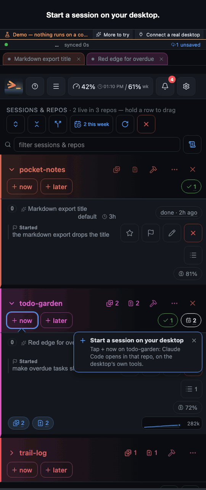
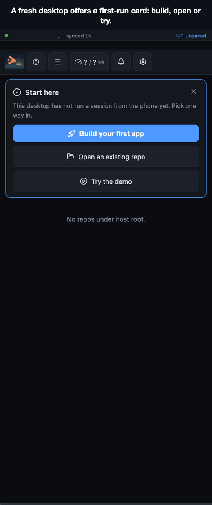
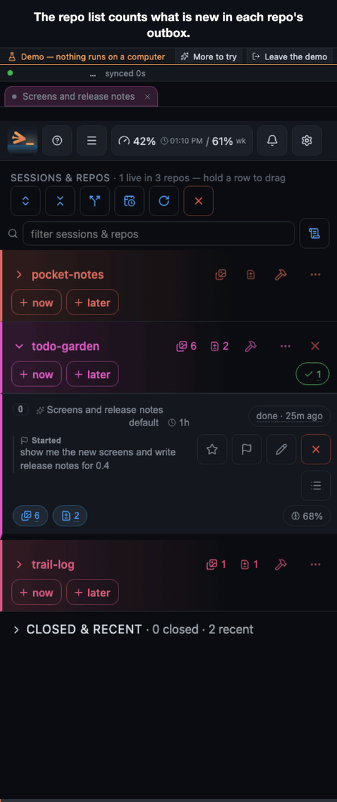
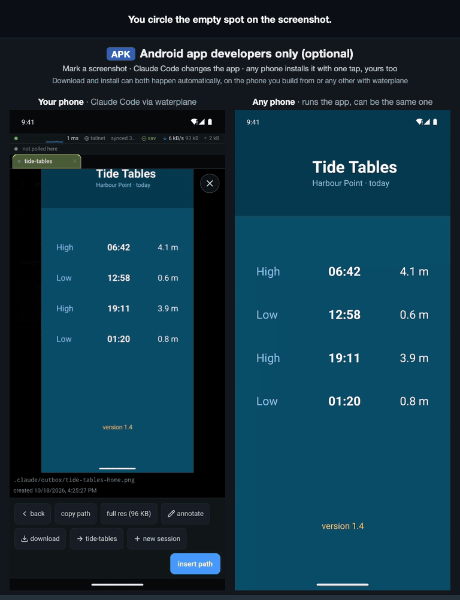
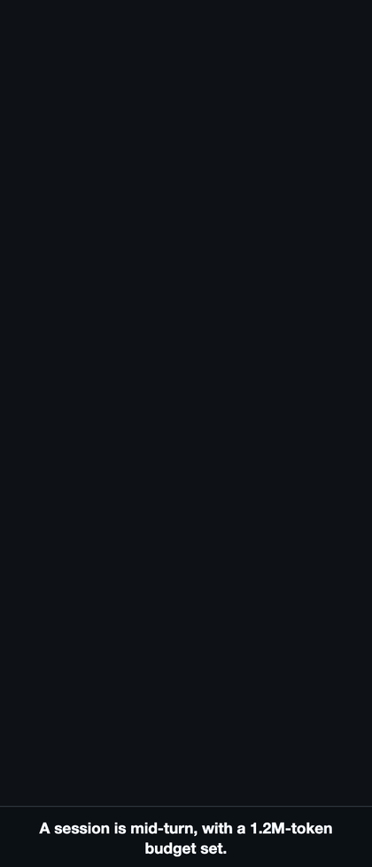
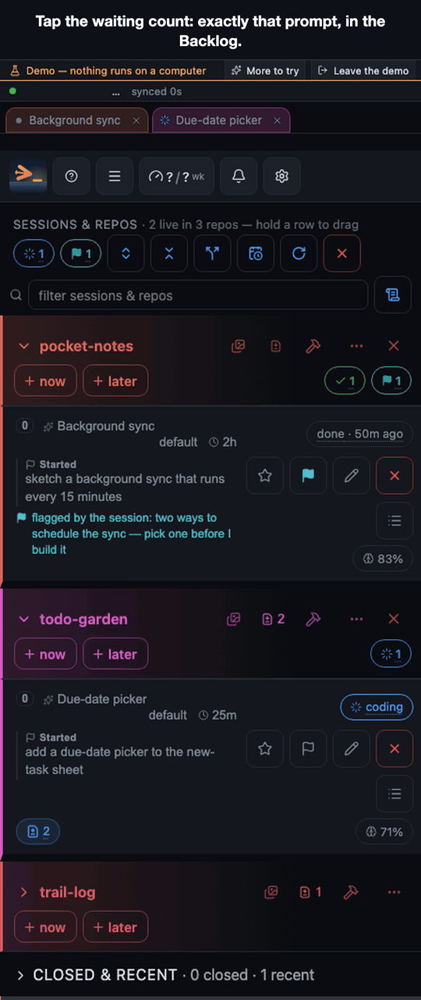
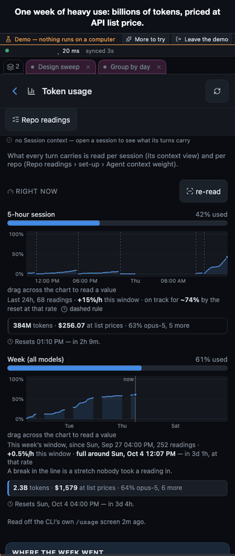
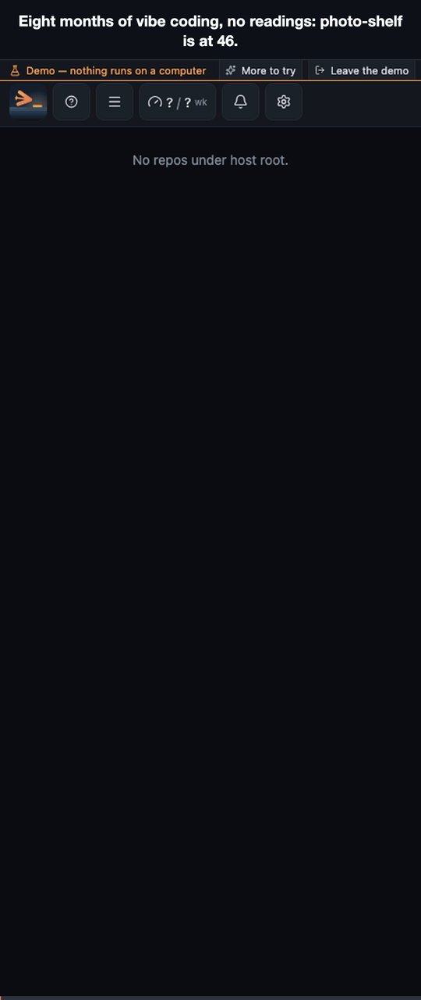
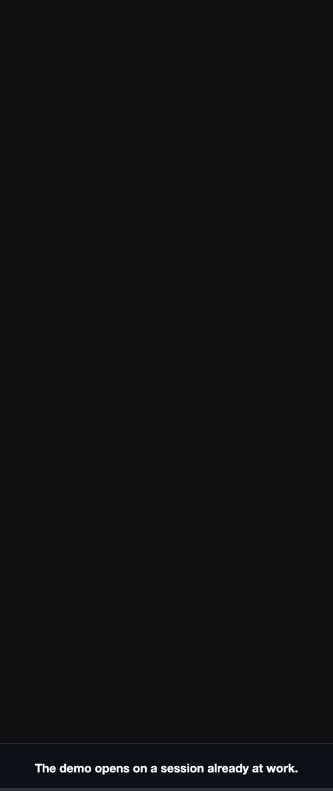

# A tour of waterplane

What the app does, one feature at a time, with a short film of each. Your phone reaches your own
desktop, over Tailscale from anywhere (recommended) or on your own network, with nothing hosted and
no account; on the desktop, the waterplane daemon runs the
real `claude` CLI in a terminal on your repos and sends the screen, screenshots and builds back.

**Every image here is made by a script, from fictional data**, and redrawn from the current code,
so none of them is a picture of an older version: the demo journeys run against the built-in demo,
a pretend desktop with fictional repos, sessions and figures; the APK install is a recording of two
Android emulators; the diagram above is an animated SVG with a rendered gif fallback.

Sections with a demo end with a **try it** link. Add the query to the address of the app (or tap
**Try the demo** on the first screen of the Android app) to walk through it yourself. The demo line
at the top says it is a demo and how to leave, and its **More to try** button lists the headline
features, one plain sentence each.

## The first minute

*A short loop. [The whole walkthrough as a video](https://waterplane-dev.github.io/media/first-look-01e0e72583.mp4), with pause and seek.*

1. **A live session.** The real `claude` terminal in a fictional repo; the demo types a prompt
   into the compose box and sends it, then tool lines stream and the context meter ticks. It is the
   actual CLI, so every slash command and dialog is there.
2. **The reader.** One tap turns the same session into a reader: markdown rendered, tool calls
   folded, an outline of the turns. Another tap goes back to the terminal.
3. **A screenshot arrives.** Claude says it saved a screenshot; a notification comes up and the
   picture lands in the gallery.
4. **Mark it up and send it back.** Draw a circle on the button, type "make this bigger", send.
   The marked-up image goes into the prompt, and Claude answers with a fix and a new screenshot.
5. **What this prompt cost.** Under the finished turn: tokens in, out and cached, dollars at list
   price, and what the next turn will cost compared with a fresh session.
6. **While you're away.** A closing card offers three ways on: schedule against your week, what it
   cost, and repo health. The sections below are those, and the rest.

When Claude stops to ask which way to go, the choices come up as buttons: you tap one instead of
typing a number into a terminal.

Try it: `?demo=first-look`

## Your first app

On a desktop that has never run a session from the phone, the first-run card builds a hello-world
page: three questions, a list of what it will create, one Go.

*A short loop. [The whole walkthrough as a video](https://waterplane-dev.github.io/media/first-app-6cdaae1d11.mp4), with pause and seek.*

The page it builds lands in `.claude/outbox/` and opens on the phone; the session then opens with a
suggested first prompt in the box. It needs a connected desktop, so there is no demo for it.

## What Claude made, on your phone

*A short loop. [The whole walkthrough as a video](https://waterplane-dev.github.io/media/gallery-and-files-9f1edea03e.mp4), with pause and seek.*

Whatever Claude leaves in `.claude/outbox/` shows up on the phone as a picture or a file, with a
badge on the repo that has something new. You can open it full size, mark it up and send the note
back, or download it. Files you pick on the phone go the other way, into `.claude/inbox/`.

Try it: `?demo=gallery-and-files`

## Build an APK, and other phones install it

*Android app developers only (optional).*

*Loops. [The whole walkthrough as a video](https://waterplane-dev.github.io/media/apk-install-ef86db40c1.mp4), with pause and seek.*

A build command saved for a repo runs from the phone without a Claude session, so it spends no
tokens. When it produces an APK, every phone running the developer build of the Android app that
you opted in for that app downloads it and installs it, and the desktop keeps a log of which version
landed on which phone. This film is a real recording of two emulators, not the demo: the demo shows
only the build sheet, because Android's own installer is never faked in a web page. In it, a
screenshot of the app is marked up in the annotator and sent as the prompt; the session's `claude`
there is a scripted stand-in (no model, no tokens) that places the logo at the circle's position, and
the build, the download and the install are the real ones.

## When the usage limit hits, it carries on

*A short loop. [The whole walkthrough as a video](https://waterplane-dev.github.io/media/limit-and-budget-d61307c1a1.mp4), with pause and seek.*

Give a session a budget and, once it is reached, the next send is held before the usage wall: your
words are kept and the reason is said. When a session does hit a Claude usage limit, the host waits
for the reset and continues it by itself, reopening the conversation with `--continue` if the CLI
had exited.

In the demo, the prompt is sent with **When free**, the deferred send a budget is allowed to hold;
a plain Send goes straight into the session, budget or not, because you asked for it now.

Try it: `?demo=limit-and-budget`

## Queue it now, or schedule it against the usage windows

*A short loop. [The whole walkthrough as a video](https://waterplane-dev.github.io/media/queue-and-schedule-a2c6c90637.mp4), with pause and seek.*

A prompt sent while the session is busy is queued and says why it waits. When the turn ends it is
typed into the same session, and its row in Activity goes from waiting to running to done. It never
disappears, it changes its verdict. A schedule can be a time, or anchored to a usage-limit reset:
right after the weekly window comes back, or two hours before it resets to spend what is left.
Schedules shows what is due soon and what is paused, and the Backlog holds work for a repo that
nobody has started yet.

Schedules shows what is due soon and which reset each rule tracks.

Try it: `?demo=queue-and-schedule`

## What it costs

*A short loop. [The whole walkthrough as a video](https://waterplane-dev.github.io/media/numbers-edb5a4da7e.mp4), with pause and seek.*

The header carries the two usage windows, the 5-hour session and the week, with when each resets.
The budget setting reads the same figures and says in words what they mean for you. Each session
has a context sheet that draws how full the window is over time and where it was compacted, and
the token screen opens on the last seven days as one number and its split (input, output, cache
read and write, dollars at list price, one column per day), then splits every total by day, repo
and model, with the dollar figure at list prices
beside it. All of it is figures the app read off the CLI's own logs and screens. Where it has
nothing to read, it shows nothing rather than a guess.

Try it: `?demo=numbers`

## Repo health

*A short loop. [The whole walkthrough as a video](https://waterplane-dev.github.io/media/repo-health-55ce394cae.mp4), with pause and seek.*

Each repo has one health score out of 100, against fixed good values for five readings: file length
(the longest file and the file the average line sits in), files reworked right after an edit,
unexplained escape hatches, untested modules and the weight of `CLAUDE.md` plus skill descriptions.
The repo list wears it as a chip; a tap opens **Repo readings** on **over time**. The score stays
within 30 of its worst entry, so one reading on fire caps it, and every warning (severe or warn)
names its offender. The trend against the first scored week comes second, then every entry's own
score, then the readings themselves: the longest file, the longest files, the re-touch rate and the
rest, one point per day. A push arrives when a reading newly turns severe. They are readings only;
the ask buttons draft a prompt and nothing changes code because of them.

Try it: `?demo=repo-health`, then tap photo-shelf's health chip.

## Alongside the Claude app

Anthropic's Remote Control lets the Claude app reach a local Claude Code session too. It is not
either/or: turn on the launch option **Remote Control** in Settings and every session waterplane
starts also runs with `--remote-control`, so the same session is open in waterplane and in the Claude
app at once. Start sessions on any repo, read, build and schedule from waterplane; glance or answer
from the Claude app when that is the app already open. That second path goes through Anthropic's
servers; waterplane's own does not.

## The demo tour

*Loops. [The whole walkthrough as a video](https://waterplane-dev.github.io/media/demo-tour-88816d7aa9.mp4), with pause and seek.*

The demo line has a **More to try** button, and the first minute's closing card links to it. It opens a list of the app's headline features, one
plain sentence each, grouped by what you want to do: drive a session, leave work running, see what
it did, know what it costs. Tapping a row opens that screen in the demo, Back returns to the
list, and a tried row gets a check. The default demo is filled in throughout, with a populated
token ledger, notifications, decisions and a sent log, so no screen you open is empty.

Try it: `?demo=first-look`, then tap **More to try**.
