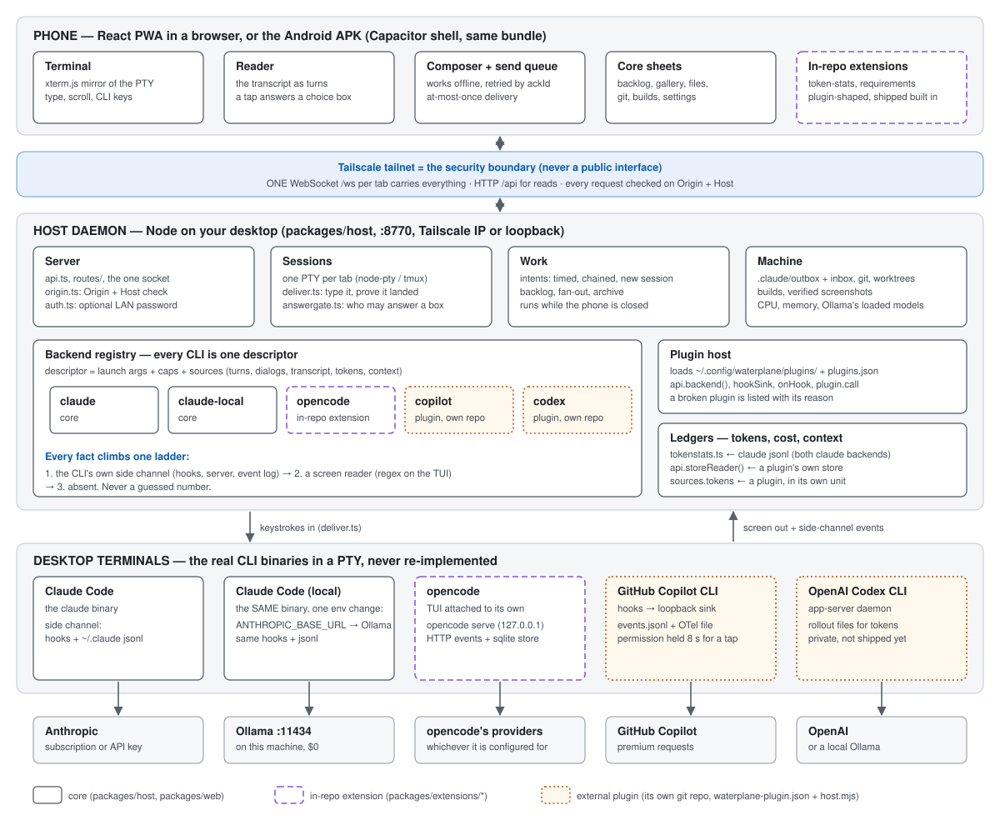
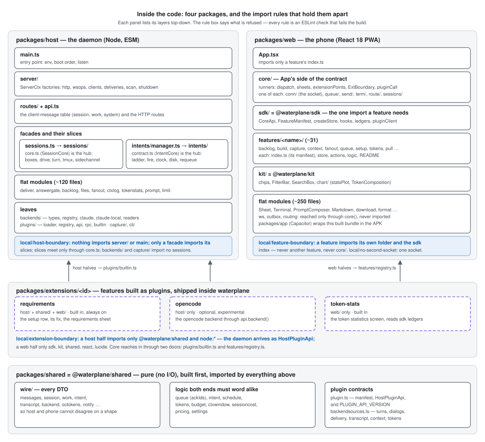
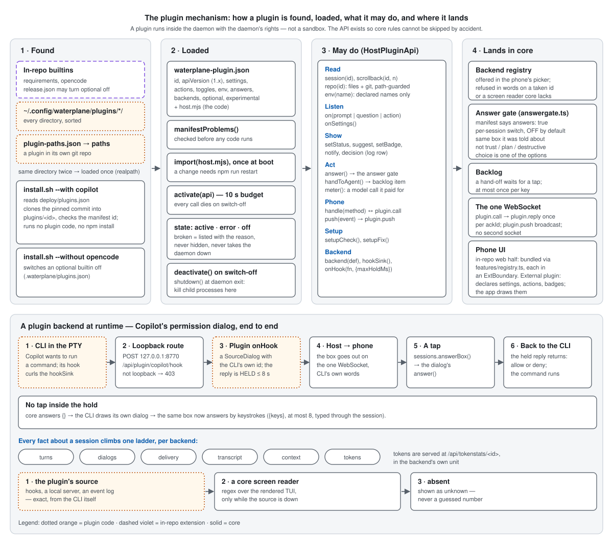

# Architecture — three views

The entry point for anyone new to the code. Three pictures, each answering one question, each
followed by the few sentences that make it readable. The detail behind every box is in the note it
links to; this file only says where things are and how they connect.

| view | answers |
| --- | --- |
| [System](#1-system--who-talks-to-whom) | what runs where, and what crosses the network |
| [Components](#2-components--whats-inside-the-code) | what the four packages hold, and the import rules between them |
| [Plugins](#3-plugins--how-waterplane-is-extended) | how a plugin is found, loaded, what it may do, and how a plugin backend works at runtime |

The SVGs live in `docs/assets/` and are drawn by hand — **when a box in them stops being true,
change the picture in the same commit as the code.** They carry light and dark colours, so they read
on GitHub in either theme and in the phone's gallery.

## 1. System — who talks to whom

- **Phone.** The same React bundle runs as a PWA in a browser and inside the Android APK
  (`packages/app`, Capacitor). It never runs a model.
- **Transport.** Your tailnet is the security boundary. One WebSocket per tab carries every message,
  plus HTTP `/api` for reads; every request is checked on `Origin` and `Host`
  ([protocol-and-security.md](protocol-and-security.md)).
- **Host.** A Node daemon on the desktop. Sessions own one PTY per tab; `deliver.ts` types a prompt
  and proves it landed; Work holds what outlives a session (timed and chained prompts, backlog);
  Machine is files, git, builds and screenshots.
- **Backends.** Each CLI is one descriptor in the backend registry. Claude Code and Claude Code on a
  local Ollama model are core; opencode is an in-repo extension; Copilot and Codex are external
  plugins in their own repos.
- **One ladder per fact.** Turn ends, dialogs, transcript, context and tokens come first from the
  CLI's own side channel, then from a regex over the screen, then they are absent. Never guessed.
- **Ledgers.** Token and cost readings stay per backend, in that backend's unit
  ([token-stats-architecture.md](token-stats-architecture.md)). Claude and claude-local share
  Claude's log files and so share one ledger; local models are counted by model id and carry no price.

## 2. Components — what's inside the code

Four packages, each with its own layering, each layering held by an ESLint rule that fails the build:

- **`packages/shared`** is pure: wire DTOs, the logic host and phone must word identically (queue,
  intents, tokens, budgets, pricing), and the plugin contracts (`plugin.ts`, `backendsources.ts`).
  Built first; everything else imports it.
- **`packages/host`** — `main.ts` → `server/` → `routes/` + `api.ts` → the two facades
  (`sessions.ts`, `intents/manager.ts`) whose slices meet only through a hub interface
  (`SessionCore`, `IntentCore`) → ~120 flat modules → leaves (`backends/`, `plugins/`, `capture/`).
  Rule: `local/host-boundary`. Detail: [host-architecture.md](host-architecture.md).
- **`packages/web`** — `App.tsx` → `core/` (the runners and the one-of-each hooks: the socket, the
  send queue, the terminal) → `sdk/` (the only import a feature needs) → ~31 `features/<name>/` →
  `kit/` (shared UI) → flat modules. Rule: `local/feature-boundary`; one socket:
  `local/no-second-socket`. Detail: [web-architecture.md](web-architecture.md).
- **`packages/extensions/<id>`** — features written against the plugin API but shipped inside
  waterplane: `requirements` (host + web), `opencode` (host only, optional), `token-stats` (web
  only). Rule: `local/extension-boundary` — a host half sees only `@waterplane/shared`, `node:*`
  and the `HostPluginApi` it is handed; a web half only the sdk, kit and shared. Core reaches in
  through exactly two doors: `plugins/builtin.ts` and `features/registry.ts`.

## 3. Plugins — how waterplane is extended

**Found.** In-repo builtins first, then every directory under `~/.config/waterplane/plugins/`, then
each path in `plugin-paths.json`; the same directory twice loads once. `install.sh --with <id>` clones a
catalogue entry from `deploy/plugins.json` at its pinned commit into the plugins directory and runs
none of its code; `--without <id>` switches an optional builtin off.

**Loaded.** `waterplane-plugin.json` is validated before any code runs; `host.mjs` is imported once
at boot (a change needs `npm run restart`); `activate(api)` has ten seconds. A plugin that fails any
step is listed with its reason, never hidden, and never takes the daemon down. `shutdown()` runs at
daemon exit for every loaded module and is where child processes are killed.

**May do.** Everything goes through `HostPluginApi`: read sessions and repo files (path-guarded),
listen for boxes, questions and actions, declare UI (status, badges, suggestions, notifications),
answer a box only through the answer gate, hand work to an agent only as a backlog item a person
taps, talk to the phone over `plugin.call` / `plugin.push` on the one socket, and register a backend.

**Trust.** A plugin runs in the daemon with the daemon's rights — this is not a sandbox. The API's
job is that core rules (the answer gate's five checks, path containment, metering) cannot be skipped
*by accident*. External plugins ship no phone code: they declare UI and the app draws it.

**A plugin backend at runtime.** The CLI's hook posts to a loopback-only route; the plugin turns it
into a dialog with the CLI's own id and holds the reply (≤ 8 s by default); the phone's tap goes
through `sessions.answerBox()` to that dialog's `answer()`, and the held reply lets the CLI go on.
No tap inside the hold ⇒ the CLI draws its own dialog and the same box answers by keystrokes.

Detail: [plugins.md](plugins.md) (seams, answer gate, decision log), the source interfaces in
`packages/shared/src/backendsources.ts`. **Why each backend lives where it does:** claude,
claude-local and claude-endpoint are core (one TUI, one jsonl, one hook pipe). opencode is an in-repo
extension, kept private, because the first proof of `api.backend()` had to be a backend that ships,
and `local/extension-boundary` is what proves it. Further CLIs are external plugins
(`plugin-paths.json`). A screen reader is core work either way: it is measured against one binary and
pinned by fixtures, so a plugin names one and never brings its own.
