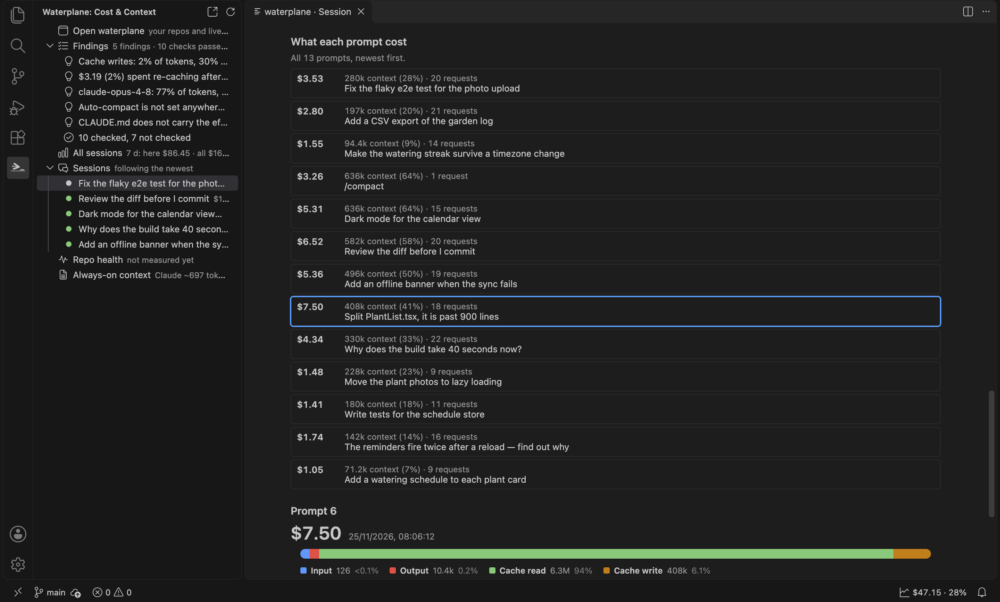
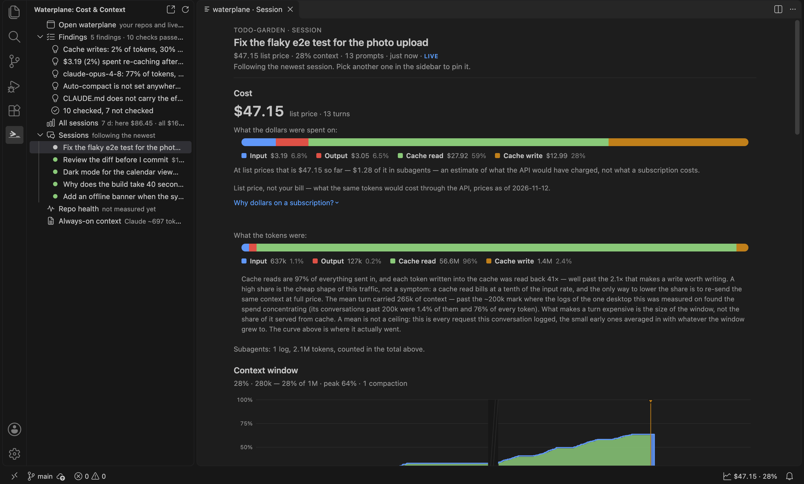
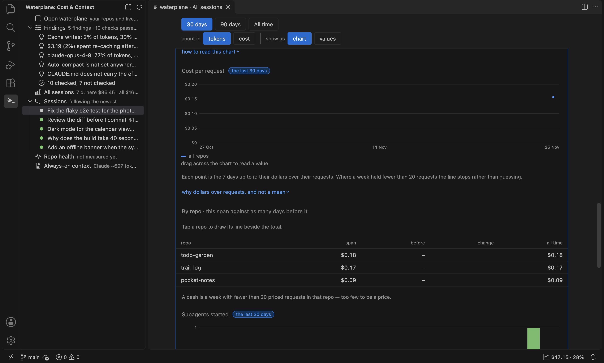
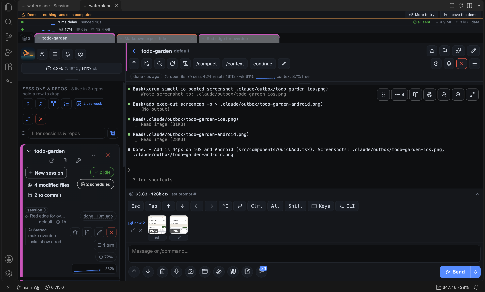
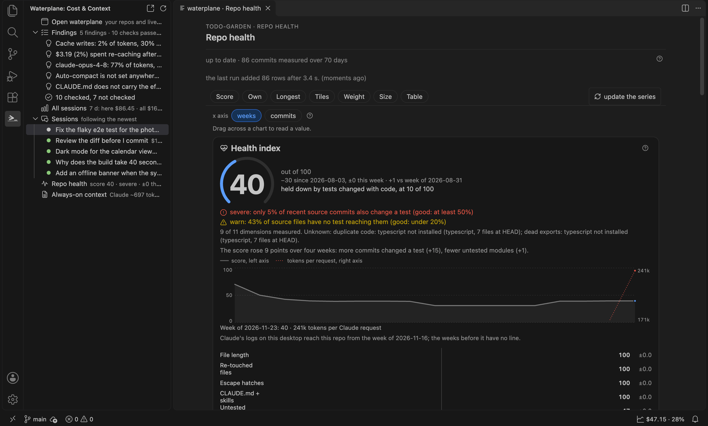

# waterplane: Claude Code Usage, Cost & Context (+ Copilot)

**See what each Claude Code prompt cost, why, and what is filling the context window.** Read from the log files already on this machine. No account, no telemetry, nothing to configure.

## Start here

1. Install it and open a folder you have used Claude Code in.
2. Click the waterplane icon in the activity bar, or run **waterplane: Open cost & context**.

Your sessions are listed at once; reading every log on the machine takes a few seconds the first time. Costs are list prices, so on a subscription they compare prompts with each other and [are not your bill](#dollars-are-list-prices-not-your-bill).

## What you get

- **The cost of every prompt**, with its tokens split into input, output, cache read and cache write, and the context it carried. The status bar shows the running session.
- **The context window over time**, with every compaction and cold cache rebuild marked, and subagents in their own lanes.
- **What your instructions cost on every request**: `CLAUDE.md`, `AGENTS.md`, Copilot instructions, rules and skills, each with who reads it. The figure also stands above the first line of the file itself.
- **Findings**: what to change in the agent's setup, ranked. Nothing is changed for you.
- **Copilot Chat** usage on this machine, and GitHub's own monthly quota when you ask for it (with the GitHub sign-in VS Code already holds).
- **Repo health over time** from the folder's git history.
- **The waterplane app in a tab**: your repos and their live Claude Code sessions, if you run the free [waterplane desktop](https://waterplane.dev) on this machine. Everything above works without it.

### Where the money went

### The whole week, per repo and hour

### Your live sessions in a tab

### Repo health

*Fictional repos and generated sessions (token shapes scaled from real use); the app tab shows the app's demo (`npm run screenshots`).*

## Every view in detail

Two parts: the **waterplane tree** in the activity bar on the left is the navigation, and the **panel** — an editor tab in the centre — shows the one view you picked there. Open both from the status bar item or with **waterplane: Open cost & context** from the command palette. Opened fresh, the panel shows **All sessions**, or the **Session** view while a session is live (written to in the last 30 minutes); while it stays open, hidden behind other tabs included, it keeps the view you left it on.

1. **Your sessions, in the tree.** The folder's conversations written to in the last day (newest first, at most 12), each with its last prompt, its cost, how full its context window is, its age and a *live* marker while it is being written to. Click one to show it in the panel; **Follow the newest session** (the default) lets go again. The list refreshes when any listed log changes, reading only the logs that changed.
2. **This prompt cost X.** Every prompt in the selected session with its cost, the context it carried and how many requests it took. Pick one to see why it was dear. A prompt that is still running is pinned at the top (`running · $0.42 so far · 7 requests · 1m 20s`) and its cost climbs as the log grows; before the first reply it says it is waiting for it. It counts as running only while the log ends mid-turn (an unanswered prompt, or a reply that stopped for a tool) and was written to in the last ten minutes, otherwise nothing is claimed.
3. **Context window over time.** Compactions and cold cache rebuilds are marked on the chart.
4. **The split.** Wherever a total appears it comes with input, output, cache read and cache write, because the kinds differ by up to 100x in price and a bare total hides it.
5. **What this folder's instructions cost on every request, for Claude Code and for Copilot.** Every instruction file in the folder is listed with who reads it and when, following each tool's documented rules: `CLAUDE.md` and `.claude/CLAUDE.md` (both; Claude Code also inlines their `@` imports), `AGENTS.md` (Copilot; Claude Code only when `CLAUDE.md` imports it), `.github/copilot-instructions.md`, `.github/instructions/*.instructions.md` (every request at `applyTo: "**"`, else when a matching file is touched, or by description), `.claude/rules` (by `paths`), and skills in `.claude/skills` (both), `.github/skills` and `.agents/skills` (Copilot): their descriptions every request, their bodies on demand. Each tool gets its own every-request figure. VS Code's instruction settings (`chat.useAgentsMdFile`, `chat.useClaudeMdFile`, `github.copilot.chat.codeGeneration.useInstructionFiles`) are honoured: one turned off drops Copilot from those files. User-level files, `CLAUDE.local.md` and nested `AGENTS.md` files are not counted. Copilot bills per request, not per token, so for Copilot this weight costs context room, not money.
6. **Optimisation prompts.** Six ready-made prompts (groom `CLAUDE.md`, shrink skill descriptions, hand off to a fresh session, why a prompt was expensive, split the file that grew most, why a health metric is rising). Copy one, or type it into the active terminal. It is typed, not sent: you press Enter. Nothing applies itself.
7. **All sessions.** The phone app's token-usage screen itself, not a copy of it: the same span filter, cards, charts and sentences, over every Claude Code log on this machine. Total over time, by model, by repo and your dearest conversations. If you also run the waterplane desktop on this machine, switch on reading it (the line at the top of the view, or `waterplane.desktopUrl`) and the view adds the live five-hour and weekly limit windows, the week since the reset, a dollar budget period and the other backends' ledgers (Copilot, local models, opencode) — exactly as the phone shows them. Reading every log takes a few seconds the first time, so it happens when you open the panel or run **waterplane: Re-read Claude Code logs**, never at startup. Each finished read leaves a small summary behind, so after a reload the tree and the status bar show the last seven days at once, with how old that reading is (`2 h ago`). A reading more than seven days old is not shown.

## In the file

Open `CLAUDE.md`, `AGENTS.md`, `.github/copilot-instructions.md`, a `.github/instructions/*.instructions.md`, a `.claude/rules` file or a skill's `SKILL.md` and a line above its first row says what that file costs: `~3.1k tokens every request · Claude Code + Copilot`; for a skill `description ~120 tokens every request · body ~2.4k on demand · Claude Code`; for a scoped instruction file `~200 tokens when a file matches src/** · Copilot`; and `nobody reads this: chat.useAgentsMdFile is off` when a setting switched it off. It is the reading on that file's row in **Always-on context**, given in tokens (the row's characters ÷ 4, as the view's headline prints them), and a click opens that view. Files the view does not count (`CLAUDE.local.md`, a nested `AGENTS.md`) get no line. The line moves when you save, not as you type.

## Repo health over time

The **Repo health** view charts how the folder's code changes over its git history: file size, the longest files, duplication, dead exports and the always-on weight, one reading per day. It is read by the extension's bundled engine, never by a script in your workspace, and it is measured only when you click **build the series** / **update the series** (or run **waterplane: Measure repo health from git history**). Opening the view only reads what was measured before. The series is stored in VS Code's global storage for this extension, not in your folder, and the view prints its path. If the waterplane desktop app has already measured the folder (`.waterplane/repohealth.jsonl`, plus a series per scope listed in `.waterplane/repohealth-scopes.json`), the view reads that series instead unless the extension's own is newer, says so, and offers the scopes; the extension only reads those files, never writes them. It grows with the history — tens of MB for a thousand-commit repo (about 51 MB measured on 1,243 commits). **Forget this series and measure again**, offered when a series is refused or cannot be read, deletes that copy and nothing else. If git is missing, the checkout is shallow or the folder is not a repository, the view says so in words instead of drawing a number.

The view is laid out as the phone's: one status line with a `?` that holds the series' details, a jump bar that sticks to the top (one chip per card on screen, and the refresh button), one **x axis** choice for every chart — **weeks** (each week's last reading) or **commits** (every reading; offered when the series scores per commit) — then a card each: the score, the longest file, the reading tiles (a two-column grid; click one to open its full chart), the always-on weight, the size of the tree, the readings as a table, and the repo's own readings.

The first card is the **health score**, as on the phone: an absolute 0–100 number per week, held down by its worst reading (an alert, in words, names it), its line over the weeks and what pushed each week up or down. Beside it, once the **All sessions** view has read your logs, a dotted line shows the context each Claude request in this folder re-sent per week — context, never part of the score. It is computed from the same series the view read, with the default context warn line; it is the one place the view takes a side, and is not drawn for a scope.

The readings come in two groups, each under its own heading as on the phone: **waterplane's readings**, measured the same way in every repo, and **the repo's own readings**, declared in the folder's committed `.waterplane-shared/health.json`. That file can also disable one of waterplane's readings or replace it with the repo's own command; the tile says so, with the repo's reason, and the file's ignored entries are listed under the heading. **The extension never runs a command that file names**: it starts only `git`, so a repo's own readings and its overrides show as absent here with that reason, and a disable (which needs nothing run) is honoured. The waterplane desktop app runs them, and a series it measured carries their numbers. When the bundled engine's definition moves on with an extension update, the extension's own copy is drawn as it is, a measure refuses to add rows under the new definition, and **Forget this series and measure again** re-cuts it.

## Copilot

**All sessions › Copilot Chat** starts with your plan and this month's premium requests counted on this machine (`Copilot Free · 12.5 premium requests this month here`), with a per-model split under *How this month is counted*. Both are read from VS Code's own files — the plan from its `state.vscdb`, the requests from Copilot Chat's session logs, each with the multiplier Copilot showed under the answer — so no sign-in and no network. Chats on other machines, github.com and the Copilot CLI are not seen, and the limit is not known locally, so this is a floor, not a share.

Below it is Copilot Chat's token use on this machine, still with no sign-in. GitHub's own figure is a separate, optional action — **read them from GitHub** at the top of that tab, or the command **waterplane: Read Copilot's quota from GitHub (asks to sign in)**: the share of premium requests and chat used, with counts and reset date. VS Code then asks once to share the GitHub account it is already signed in with; Cancel keeps the local count. Sessions, costs and the context window are Claude Code's only.

## Subagent lanes

A session's subagents get their own lanes under the context chart and their cost is part of the session total — or the total is withheld when their logs cannot be read.

## The tree

The waterplane icon in the activity bar opens the tree: **Findings** first (what to change in the agent's setup, ranked, with a last row for what was checked and found fine and what could not be checked), then **All sessions**, with the last seven days (`7 d: here $14 · all $80 · 2 h ago`; no age right after a read), then **Repo health** and **Always-on context**, each with a one-line headline. **Sessions** (the recent ones, as above) sits second and open while a session is running or was written to in the last 30 minutes, and last and closed when none is; once you fold or open it yourself against that, your choice stays. A click shows that view in the panel; the panel itself has no tab bar and no session list, so nothing is on screen twice. The tree never scans all your logs, only the few listed sessions.

The `here` figure counts sessions started in the open folder itself, including its own `.claude/worktrees`; a sub-folder opened on its own counts only sessions started there, and a folder with no priced session in the last seven days shows `all` only. Figures are list prices, never `$0`: a week with nothing priced is given in tokens.

The status bar item follows the same rule. While a session is being worked on it shows that session (`$4.21 · 38%`: its cost and how full its context window is); otherwise the last seven days (`7 d here $14` for this repo when known, else `7 d all $80`), with the split on hover; a reading over a day old says its age there too (`7 d here $14 · 3 d ago`). With neither, or with a reading over seven days old, it hides.

With several workspace folders open, the panel follows the folder of your active editor; the tree's folder row picks another.

## The app in a tab

**waterplane: Open waterplane** (command palette, or the first row of the waterplane tree) opens the waterplane app in an editor tab: the same app as on the phone, with your repos and their live Claude Code sessions. It needs a waterplane desktop already running on this machine ([how to install it](https://github.com/waterplane-dev/waterplane/blob/main/docs/install.md)), at `http://127.0.0.1:8770` or at the loopback address in `waterplane.desktopUrl`. The extension never starts one and runs no command; when none answers, the tab says so and offers to check again.

A tap on a link in the app opens it in your browser, the link icon at the top right of the tab opens the app itself there, and the refresh icon loads the tab afresh. The microphone and notifications do not work inside a VS Code tab; use the browser for those. In a remote window (SSH, WSL, a container, VS Code in a browser) the app is not opened: there, loopback is shared with everyone who has an account on that machine.

## Privacy

- No telemetry. One network request, off until you turn it on: **read them from GitHub** on All sessions › Copilot Chat reads `api.github.com/copilot_internal/user` with the GitHub sign-in VS Code already holds — GitHub's internal endpoint, so a shape the extension does not know shows as no figure — then again every 10 minutes. **stop reading GitHub** in the same place turns it off.
- Off until you turn it on: **token readings from the waterplane desktop on this machine** (`waterplane.desktopUrl`, or the switch at the top of All sessions) — plain `GET`s of its read-only token routes, and only to a loopback address (`127.0.0.1`, `localhost`, `::1`); any other host in the setting is refused, and nothing is sent but the request.
- Only after you run **waterplane: Open waterplane**: one `GET` of `/api/health` per check at that same loopback address (or the default one, when the setting is empty), then the app's own page from it, in a frame that can show no page from any other address. The framed app can ask the extension for one thing, to open an `http` or `https` link in your browser; it cannot read your files, your clipboard or the editor through it. In a remote window nothing is contacted.
- It reads only the `claude` CLI's local logs under `~/.claude/projects` (or `CLAUDE_CONFIG_DIR`), plus the agent-instruction files listed above in your workspace folder.
- The repo-health engine runs `git` on this machine against the folder's own history — read-only object reads (`rev-list`, `log`, `ls-tree`, `cat-file`); it never runs `git fetch`, `pull` or `push`, never touches the index or the working tree, and writes its series only into VS Code's global storage for this extension. `dist/healthworker.mjs` is the one file that can start a process, and the only program it starts is `git` — never a command a repo declares in `.waterplane-shared/health.json`.
- It reads, and never writes, a waterplane series already in your folder (`.waterplane/repohealth*.jsonl`).
- It writes only its own cache and series, in VS Code's global storage for this extension.
- What it opens in a browser, when you click it: a link to waterplane.dev or the extension marketplace, and from the app tab the app itself, its install page, or a link in the app.

## Dollars are list prices, not your bill

Costs are what the API would have charged at published list prices (as of the date shown in the panel), computed from the token counts in the logs. If you use Claude Code on a subscription, you pay a flat fee instead. The figure is useful because it weighs each kind of token by its own rate, so prompts, sessions and models can be compared. It is an estimate. A model with no published rate is counted in tokens and left out of the dollars; it is never shown as `$0`.

## Settings

| Setting | Default | What it does |
|---|---|---|
| `waterplane.statusBar` | `true` | Show the live session's cost and context in the status bar, or the last seven days' cost when no session is live. |
| `waterplane.pollSeconds` | `5` | How often the active session log is re-checked when file watching misses a write (minimum 2). |
| `waterplane.claudeConfigDir` | empty | Override the claude CLI's config dir (else `CLAUDE_CONFIG_DIR`, else `~/.claude`). |
| `waterplane.healthSeconds` | `600` | How long one repo-health measurement may run before it is stopped; rows measured so far are kept and the next measure continues. |

## Commands

- **waterplane: Open cost & context**
- **waterplane: Open waterplane**: the app in an editor tab.
- **waterplane: Open in browser**: the app tab's app in your browser, while that tab is active.
- **waterplane: Reload the app tab**: checks for the desktop again and loads the tab afresh, while it is active.
- **waterplane: Re-read Claude Code logs**
- **waterplane: Copy an optimisation prompt**
- **waterplane: Measure repo health from git history** (`waterplane.healthRefresh`): opens the Repo health view and measures the active folder.

## Drive these sessions from your phone

waterplane is also a phone app that remote-drives the real `claude` CLI on your desktop over Tailscale, with these same cost and context readings on the phone. See [waterplane.dev](https://waterplane.dev).

"Claude Code" and "Copilot" are named here only to say whose logs are read. This extension is not made or endorsed by Anthropic, GitHub or Microsoft.

## License

MIT
